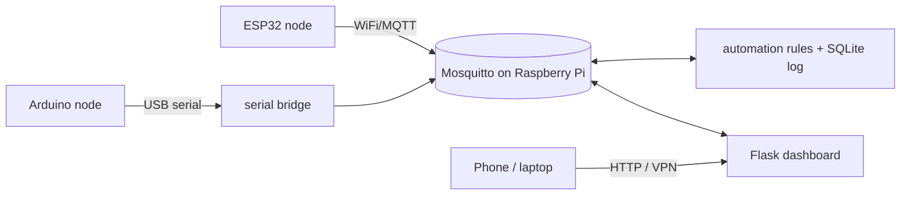

# IoT Smart Home System

[](https://github.com/Git76Hub/smart-home-iot/actions/workflows/ci.yml)

A small but complete smart home network for a Computer Networking course project. Sensors and
actuators on an **ESP32** and an **Arduino** talk through an **MQTT broker** running on a
**Raspberry Pi**. **Python** services add automation and data logging, and a **web dashboard**
(works on phones) provides live monitoring and remote control.

**No hardware yet?** Run the built-in device simulator and see everything working in two minutes.



## Features

- MQTT topic scheme with retained state, Last Will presence and QoS 1 commands
- Mosquitto with password auth, per-user ACLs and an optional TLS listener
- Rule engine: fan follows temperature (with hysteresis), hallway light follows motion, global auto-mode switch
- Responsive dashboard: live readings, toggles, device online/offline status, history charts
- Hardware-free simulator, unit tests and CI
- Measurement tools for the report: QoS benchmark, command latency, MQTT vs HTTP overhead
- systemd units to start everything on boot

## Quick start (simulator, no hardware)

You need Python 3.10+ and a Mosquitto broker. On the Raspberry Pi or any Debian/Ubuntu machine:

```bash
git clone https://github.com/Git76Hub/smart-home-iot.git && cd smart-home-iot

sudo ./broker/setup_broker.sh '<admin-password>' '<node-password>'   # installs + configures Mosquitto

python3 -m venv .venv && source .venv/bin/activate
pip install -r requirements.txt

cp .env.example .env            # set MQTT_PASS to the admin password
./scripts/run_demo.sh           # automation + simulator + dashboard
```

Open **http://localhost:5000**. The temperature climbs, the fan switches on at 28 °C and the
room cools, and random motion triggers the hallway light. Toggle things from the page.

macOS/Windows: run Mosquitto yourself (Homebrew or the installer), create users with
`mosquitto_passwd`, and reuse `broker/smarthome.conf` and `broker/acl`.

## Real hardware

1. Wire the boards: [docs/hardware.md](docs/hardware.md).
2. Flash `firmware/esp32_node` (copy `secrets.h.example` to `secrets.h`) and `firmware/arduino_hall_node`.
3. Plug the Arduino into the Pi, set `SERIAL_PORT` in `.env`, then run:
   ```bash
   python -m smarthome.serial_bridge    # Arduino <-> MQTT
   python -m smarthome.automation       # rules + logging
   python -m smarthome.dashboard.app    # web UI
   ```
4. To start at boot: `sudo ./deploy/install_services.sh`

## Remote access

Do not forward port 1883 or 5000 to the internet. Install **WireGuard** or **Tailscale** on the Pi
and open the dashboard through the VPN address. Set `DASH_USER` / `DASH_PASS` in `.env` to require a
login, and enable TLS for MQTT ([docs/experiments.md](docs/experiments.md#7-security)).

## Project layout

```
broker/        Mosquitto config, ACL, setup script
firmware/      ESP32 (WiFi/MQTT) and Arduino (serial) sketches
smarthome/     Python package: automation, serial bridge, simulator, dashboard
tools/         QoS benchmark, latency test, overhead calculator, cert generator
tests/         pytest suite for the rules, database and dashboard API
deploy/        systemd units
docs/          architecture, wiring, network experiments
```

## Documentation

- [Architecture and topic reference](docs/architecture.md)
- [Hardware and wiring](docs/hardware.md)
- [Network experiments for the report](docs/experiments.md)

## Configuration

All settings live in `.env` (see `.env.example`): broker address and credentials, TLS CA,
serial port, rule thresholds (`FAN_ON_TEMP`, `FAN_HYSTERESIS`, `LIGHT_OFF_DELAY`), dashboard port and login.

## Tests

```bash
pytest -q
```

## Troubleshooting

| Symptom | Check |
|---|---|
| Dashboard says "Broker offline" | `systemctl status mosquitto`; credentials in `.env` |
| Connection refused (rc=5) | wrong user/password, or the ACL blocks the topic |
| ESP32 never connects | `MQTT_HOST` must be the Pi's LAN IP; check `secrets.h` |
| Serial permission denied | `sudo usermod -aG dialout $USER`, log out and in |
| Device shows "offline" | Last Will fired: it lost its connection |

## License

MIT, see [LICENSE](LICENSE).
