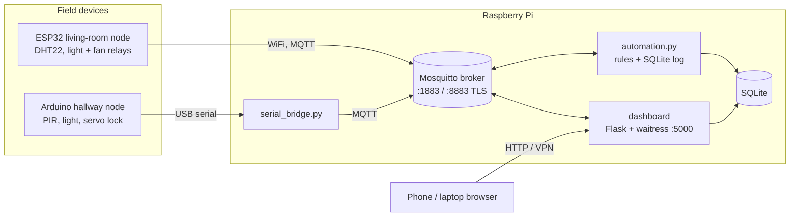

# Architecture

## Design decisions

- **MQTT, not HTTP, between devices and the Pi.** Small packets, persistent connections,
  publish/subscribe decoupling, built-in delivery guarantees (QoS) and presence (Last Will).
- **The browser never speaks MQTT.** The dashboard server holds the broker credentials and
  exposes a small whitelisted REST API, so a phone only needs HTTP and no secrets reach the client.
- **State vs. command topics.** Devices publish to `.../state` and only listen to `.../set`.
  A command is confirmed when the device echoes the new value on `.../state`, so the UI always
  shows what the hardware actually did.
- **Retained state, non-retained events.** Actuator state is retained, so new subscribers
  (a freshly opened dashboard) see it immediately. Motion events are not retained.
- **Rules are pure code.** `RuleEngine` has no I/O, so it is unit tested without a broker.
- **Least privilege.** Field devices use the `node` user, which can publish state and read
  commands only. The Pi services use `admin`. See `broker/acl`.

## Topic reference

| Topic | Direction | Values | Retained |
|---|---|---|---|
| `home/livingroom/temperature/state` | device -> | `24.5` (°C) | no |
| `home/livingroom/humidity/state` | device -> | `55` (%) | no |
| `home/livingroom/light/{state,set}` | both | `ON` / `OFF` | state: yes |
| `home/livingroom/fan/{state,set}` | both | `ON` / `OFF` | state: yes |
| `home/hallway/motion/state` | device -> | `0` / `1` | no |
| `home/hallway/light/{state,set}` | both | `ON` / `OFF` | state: yes |
| `home/frontdoor/lock/state` | device -> | `LOCKED` / `UNLOCKED` | yes |
| `home/frontdoor/lock/set` | -> device | `LOCK` / `UNLOCK` | no |
| `home/system/auto/{state,set}` | both | `ON` / `OFF` | state: yes |
| `home/devices/<id>/status` | device -> | `online` / `offline` (Last Will) | yes |

## Adding a device

1. Choose `home/<room>/<device>/state` (and `/set` if it can be controlled).
2. Publish from the device; optionally add a constant in `smarthome/topics.py`.
3. To show it in the UI, add the key to `CONTROLS` in `dashboard/app.py` and a row in `index.html`.
